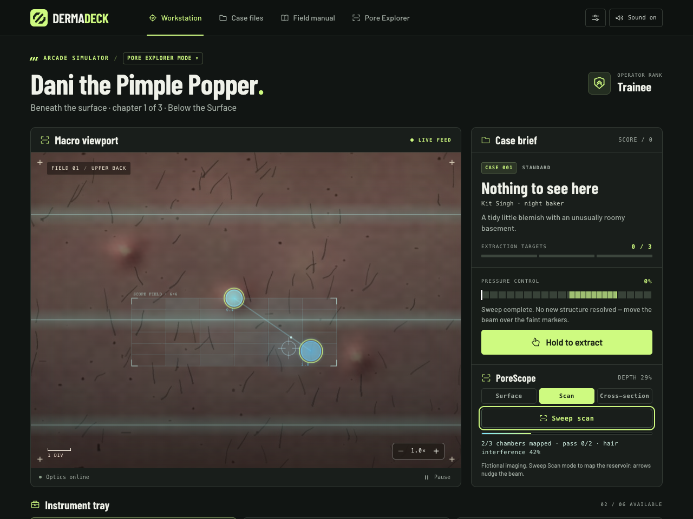
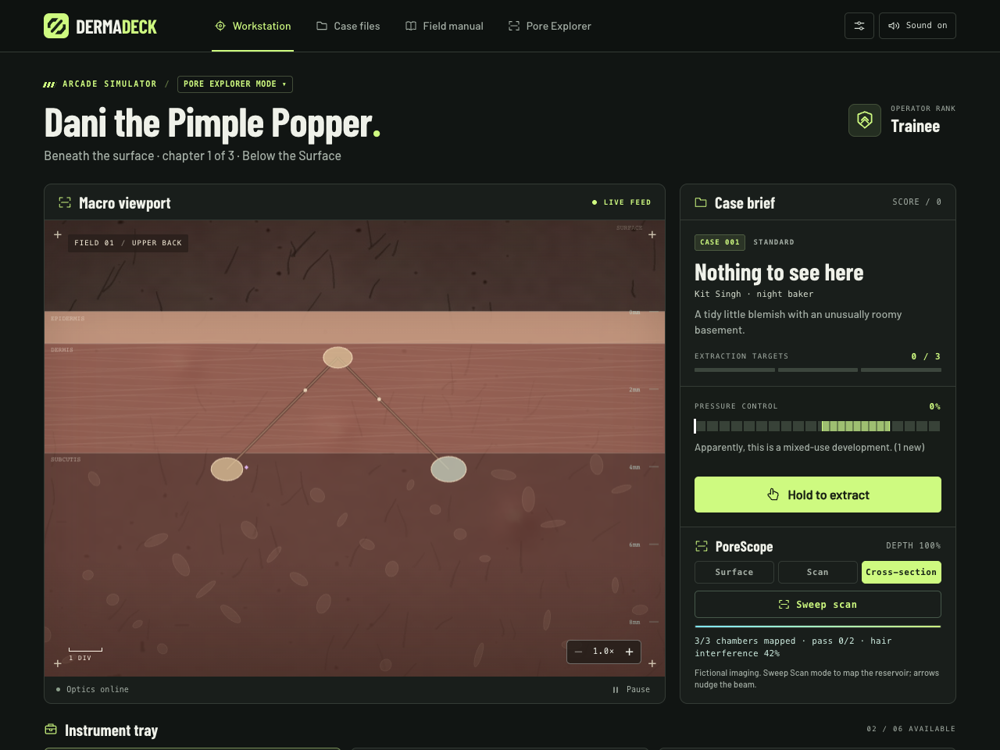
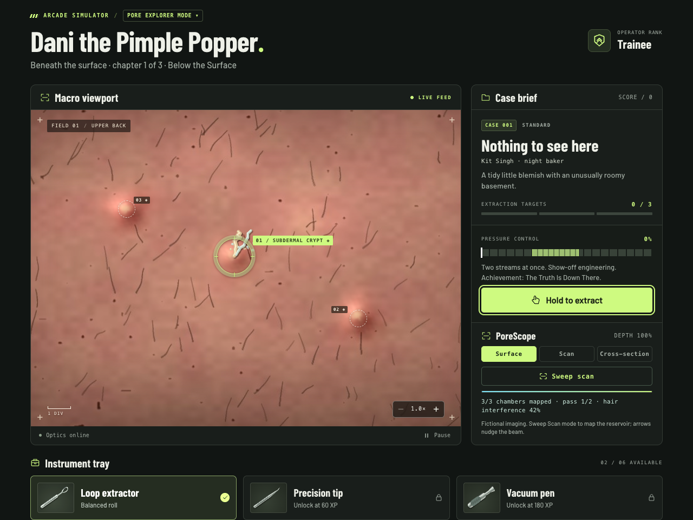
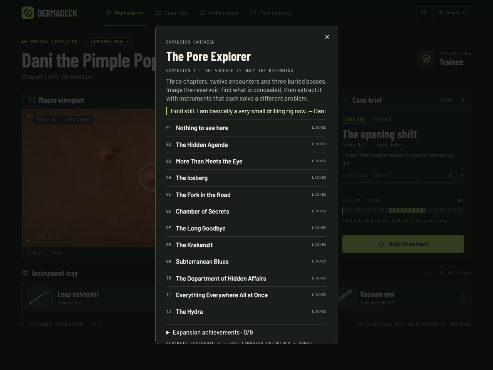

# Dani the Pimple Popper 1.1 — The Pore Explorer

The public entry point is [dani-the-pimple-popper.html](../dani-the-pimple-popper.html). Serve the repository over HTTP on localhost or HTTPS. The first online visit installs the base game for offline play. The game registers its worker for the canonical and legacy game filenames. Both use the same bounded asset cache.

Existing installations keep their manifest ID, `danny-popper` database and both campaign checkpoints. The old bookmark works offline with its installed release. After reconnecting, open it to receive the updated worker, then reopen the game. The legacy worker can run the corrected shell at the old address until the canonical scope is ready for offline launches. A device that has never received the update needs a connection before it can first open the new URL.

## Game systems

| Module | Responsibility |
| --- | --- |
| `danny/content.js`, `danny/base.json` | Load authored manifests, resolve namespaced IDs, and expose the content catalog. |
| `danny/simulation.js` | Generate repeatable patients and fields, evaluate instrument curves and boss release bands, and step the material simulation. |
| `danny/render.js` | Sample region photographs with pressure-dependent UV displacement and shading in Three.js/WebGL2. Composite tool contact and simulated material. Fall back to a shaded Canvas field when WebGL2 is unavailable or its context is lost. |
| `danny/input.js`, `danny/audio.js` | Handle pointer capture, cancellation and keyboard holds. Synthesize instrument contact, release, misses, timing cues and completion sounds. |
| `danny/progression.js` | Resolve encounters and mode checkpoints, apply score and XP, fit upgrades, award achievements, and migrate preview saves. |
| `danny/storage.js` | Commit the current profile and previous checkpoint together in IndexedDB. Detect stale writers. |
| `danny/game.js` | Connect the systems to the workstation, field reports and accessibility settings. |
| `danny/reservoir.js` | Engine 1.1 primitive: deterministic reservoir graphs, replayable drainage, gates and material accounting. Imported only by the expansion module. |
| `danny/pore-explorer/*` | The Pore Explorer pack, its on-demand module and the PoreScope imaging model/painter. |

The base campaign consists of four chapters with a regular patient and a boss patient in each. Endless Clinic chooses a fresh seeded field each shift and schedules a boss every fourth patient. Zen accepts any release pressure and leaves score and XP alone. Each mode resumes its own patient. The case files show earned achievements and fitted upgrades.

Expansion 1 adds a sibling campaign plus expansion Endless and Zen modes, each with its own checkpoint. Expansion records are only present after the pack loads; until then the base modes, tray, files and manual behave exactly as in 1.0.1.

## First-party content contract

A pack is a same-origin JSON manifest. The engine exposes `createRegistry()` for isolated catalogs and `content` for the game catalog. The application awaits `baseReady` at startup. The optional source map is empty in 1.0. On resume the engine resolves only the namespaces required by the active mode, equipment and encounter, and checks their major versions. A future first-party entry point can await `content.load(relativeManifestURL)` when a player enters that content. The current release invokes this loader only for the base pack. Repeated requests for a URL share a promise. Failed loads can be retried.

Every manifest declares a unique lowercase `namespace`, a semantic `version`, and integer `engineMajor` (currently 1). Record IDs take the form `namespace:slug` and must be unique across all categories. References may point to records in the same manifest or a previously registered pack. The loader stages a whole manifest, checks collisions and typed references, then registers it atomically. The base manifest serves as the working example for every record family.

| Array | Fields and engine meaning |
| --- | --- |
| `assets` | `kind` is `image` or `audio`. Resolve `src` relative to its manifest. Registration records a URL. A region decodes its image on entry. Equipment can decode an optional audio sample on first release. |
| `regions` | `name`, `image` asset ID, positive `elasticity` and `oil` multipliers for tissue displacement and specular response. |
| `materials` | `viscosity`, `cohesion` and `adhesion` in [0,1], and CSS `color` and `highlight`. These drive drag, chain constraints, outlet attachment, droplets, and contact friction. |
| `archetypes` | `name`, `material` ID and integer `shape` selecting a pale cap (0), dark plug (1), or congested opening (2). |
| `equipment` | `name`, descriptive `type`, `technique` (roll, pulse, suction), positive `speed`, normalized half-width `window`, unlock `xp`, tray/contact `art` (0–2), and optional `audio` asset ID. |
| `upgrades` | `name`, unlock `xp`, additive `windowBonus`, multiplicative `speedScale`. Earned upgrades fit automatically. |
| `behaviors` | Select an engine `pattern` (layers, drift, breakaway, alternating). Set `layers`, `pace`, `window` multiplier and normalized `shift`. Each completed pass persists. |
| `bosses` | `name`, `hint`, `behavior` and `archetype` IDs. The boss occupies the final field slot and unlocks after its other targets clear. |
| `encounters` | `name`, `flavor`, `region`, integer `seed`, `count` (1–6), nonempty `archetypes` list, optional `boss`. |
| `chapters` | `name`, positive `difficulty` multiplier and ordered `encounters` IDs. |
| `modes` | `name`, `description`, `strategy` (campaign, endless, zen), ordered `chapters` IDs and `scoring` ID. Registered modes appear in the shift picker. Endless schedules require regular and boss encounters. |
| `achievements` | `name`, positive `threshold`, and a profile counter in `stat` (total, perfects, bestStreak, bosses, chapters, endlessFields, zenFields). |
| `scoring` | `clean`, `perfect`, `streakStep`, `streakCap`, `bossBonus` and `caseXP`. The mode selects its rule by ID. |

A new behavior primitive requires a reviewed addition to the engine's pattern table and simulation code. Data packs can compose the built-in primitives. The loader accepts data and same-origin media references. The engine contains all executable behavior.

The base worker's install list contains base assets only. A future pack that supports offline use should cache its selected manifest and assets after entry, under a bounded, versioned pack cache. Register its packaged URL in a first-party route. An expansion management screen is outside the release scope.

## Save compatibility and recovery

Schema 2 stores stable mode, encounter, tool, achievement and pack IDs. A mode slot contains its patient seed, shift counter, cleared target indices, pass counts, current score, and streak. A release commits at a discrete boundary. An interrupted hold resumes at the last committed pass. Retain encounter seeds, target order, count and archetype meaning for published IDs. Give substantially changed layouts new IDs. Preserve IDs across compatible pack versions. A breaking pack update requires an explicit migration and fixture from the preceding release.

One IndexedDB object store holds `current` and `previous`. Every write compares the current revision and parent checkpoint token and advances it atomically. A stale tab gets an actionable status. A malformed current record falls back to a valid previous checkpoint. The preview migration maps its six numeric cases and three instruments onto stable IDs and preserves cleared targets, XP, sound, and operator totals. A future save format or unavailable active content opens a temporary session and protects the saved records. Inactive pack slots and unknown achievement IDs survive normal saves. Resetting all shifts removes the prior checkpoint and writes a fresh profile.

## Verification

Run `node tests/danny-popper.cjs` from the repository root with Chrome and Playwright installed. It serves a GitHub Pages-style subpath and exercises the base game through browser input. Run `node tests/dani-release.cjs` to test the installed 1.0 worker upgrading on the same origin, both launch URLs, and checkpoint preservation. The compatibility test reads the original release from Git history. The static shell includes its licensed fonts, Three.js and all base region textures.

Run `node tests/dani-pore-explorer.cjs` for the expansion. It covers manifest registration and lazy loading, namespace isolation, deterministic graph generation and hidden placement, material accounting, chamber activation and gate semantics, every encounter and boss, all three instruments, the nine expansion achievements, independent checkpoints, a 1.0-shaped save, the offline expansion cache, the legacy URL, and both renderers. `bash tests/audit-storage-heuristics.sh` checks page conventions.

Physical-device testing of the expansion is still outstanding. The automated suite runs Chrome under a software rasterizer on macOS; it does not establish touch feel, thermal behaviour or real GPU timing on a phone. Record device, input method, observed response and player comments when that playtest happens.

The remaining expansion concepts stay reserved: Dani's Disgusting Day Spa, The Guinness Book of Pores, and The Midnight Clinic.

### Art sources

The original cheek photograph and four regional plates were generated with the built-in image generation tool. The renderer adds the playable lesions, tissue response and expelled material at runtime. `skin.jpg` is the cheek plate. The four quadrants of the second plate became `forehead.jpg`, `jaw.jpg`, `nose.jpg`, and `temple.jpg`.

Source prompts

> Photorealistic extreme macro photograph of a small field of warm peach human cheek skin, full bleed edge to edge, camera almost perpendicular to skin surface with very slight slope. Fine pores, organic creases, a few nearly translucent vellus hairs, subtle rusty rose flushing, naturally varying skin relief. Soft directional clinical light from upper left, realistic specular skin oils, optical macro focus crisp across central field and softer toward edges. No distinct large pimples, objects, tools, wounds, text, graphics, or borders. Landscape 3:2, for the base texture in a fictional macro simulation.

> A 2 by 2 contact sheet of four photoreal dermatological macro skin texture photographs for a fictional game, no borders, no text, no gutters. Each quadrant is a distinct edge-to-edge magnified patch of healthy skin, no face silhouette. Upper left: warm medium brown forehead with subtle curving horizontal micro-folds and fine sheen. Upper right: bronze jaw/chin with sparse short dark stubble, subtly faceted pores. Lower left: pale rosy nose with larger sebaceous pores and specular oils. Lower right: rich deep brown temple, fine vellus hairs and soft interlacing lines. Natural macro-photographic detail, overhead view, same soft directional light upper left, no implements, no blemishes or wounds. Square canvas, strict four equal square photographs.

## Expansion 1: The Pore Explorer

The surface is only the beginning. Expansion 1 adds a diagnostic imaging instrument, a reservoir
network simulation, six extraction behaviours, three instruments, six anatomical regions, three
chapters with three bosses, nine achievements and expansion-specific commentary. It is implemented
inside the same first-party manifest architecture, and the base campaign is unchanged when the pack
is not loaded.

### Loading contract

| Step | Behaviour |
| --- | --- |
| Startup | Only `danny/base.json` is fetched. `reservoir.js` ships in the base offline shell but nothing imports it until the expansion module loads. |
| Entry | `#poreBtn`, the mode chooser, or a saved expansion checkpoint. `ensureExpansion()` loads `danny/pore-explorer/pack.json` through the same staged registry, then imports `pore-explorer/expansion.js` with a dynamic import. |
| Resume | `restoreContent()` already resolves the namespaces named by the saved mode, tool and encounter. `optionalSources` now maps `pore-explorer` to its pack, so a checkpoint inside the expansion downloads only what it needs. |
| Offline | The base worker precaches the shell. A second runtime cache (`junkdrawer-danny-expansion-*`) fills from same-origin `/danny/pore-explorer/` requests. When the expansion was opened before a first-visit worker took control, `primeOffline()` re-fetches the pack, modules and plates once on `controllerchange`, so the cache is complete without a reload. The cache is deleted on the next release. |
| Failure | A pack or module that cannot load leaves the base campaign and every checkpoint untouched; the game reports the failure and continues in a temporary session. |

Repeated requests share one promise, packs register atomically, and a pack may reference records
from a manifest registered before it (the expansion references base materials, archetypes and
`base:shift-score`). Registering the same namespace twice is an error; a different URL serving a
duplicate namespace is rejected exactly like a duplicate ID.

### Engine 1.1 contracts (all optional)

| Addition | Meaning |
| --- | --- |
| `reservoirs` family | `pattern` is one of `fork`, `ribbon`, `strata`, `chain`, `braid`, `migrate`. `chambers` is a `[min,max]` count (≤14 total nodes), `scale` multiplies chamber volume, `materials` is a non-empty list, `hidden` is the concealed-compartment count and `obstruction` is `none`, `plug`, `valve`, `septum` or `migrate`. |
| Reference fields | `archetypes.reservoir`, `bosses.reservoir`, `behaviors.reservoir`, `encounters.reservoir`, `encounters.behaviors`, `encounters.mystery`, `tutorials.equipment`. |
| Equipment | `scope` restricts an instrument to one pack namespace. Techniques add `probe` (diagnostic pulse), `vortex` (two flow units per release) and `resonance` (breaks one obstruction). `art` accepts 0–5. |
| Behaviours | Patterns add `stutter` (band flips) and `surge` (band falls with each pass and pulses). |
| Regions | `hair` (0–1), `grain` and `curve` are optional metadata. Hair adds instrument drag and reduces scan clarity; the base seven regions carry none, so base physics is unchanged. |
| `commentary`, `tutorials` | Authored text families. Commentary is selected deterministically by event and salt; tutorials are short step lists with an optional instrument reference. |

### Reservoir simulation

`danny/reservoir.js` is the reusable primitive. A template plus a seed produces a graph; a graph plus
committed progress produces the entire observable state. Nothing is animated from a hidden timeline.

- **Generation.** `build(template, seed)` derives chamber count, volumes, depths, materials, concealed
  compartments and gate placement from one seeded generator. Gates preferentially sit on articulation
  edges, so a valve severs a subtree instead of being bypassed by a cycle.
- **Draws.** Each committed release pulls one volume unit (`DRAW`) from the reachable frontier, nearest
  chamber first, spilling outward. Empty chambers remain conduits. A hub that empties drains 55% of a
  unit from each revealed neighbour as a secondary release — the cascade behind The Hydra.
- **Concealment.** Hidden chambers are excluded from flow until imaging resolves them or draining the
  chamber in front of them exposes them. Exposure is derived, not stored, so a checkpoint cannot
  disagree with the field.
- **Obstructions.** Valves and plugs block traversable edges until a resonance pass records that gate.
  A migrating plug occupies a different articulation edge for each draw; a resonance pass records the
  draw index, so the checkpoint stays a short integer list.
- **Bounds.** ≤14 nodes, ≤64 committed passes, one 6×6 coverage grid (two hex digits per cell), a depth
  gain of 0–48 and ≤24 gate entries per target. Replay is bounded by those numbers.
- **Determinism.** `replay(graph, progress)` is pure. Tests compare serialized graphs for one seed,
  prove different seeds differ, check volume conservation, and assert that a reload reconstructs the
  same network.

Progress lives in the existing slot as `deep[targetId] = {c, d, g}`. It is cleared whenever the case
changes, so one patient's scan map never leaks into the next.

### Imaging

`danny/pore-explorer/porescope.js` paints on the existing 2D effects canvas and never touches the skin
shader, so WebGL2 and the shaded Canvas fallback present identical imaging. Surface, Scan and
Cross-section are cross-faded. Coverage is spatial: sweeping the beam fills a cell and, at lower
weight, its neighbours; depth gain accumulates only while the instrument is held on the field. The
PoreScope sweeps faster and deeper than a borrowed extraction tool, but its releases are diagnostic
pulses that never move material. Imaging paints under the expelled material and instrument silhouette
so an extraction stays readable in every view.

### Instruments

| Instrument | Interaction | Trade-off |
| --- | --- | --- |
| Loop extractor, Precision tip, Vacuum pen | Unchanged base techniques. | Base kit remains available in the expansion. |
| PoreScope | Fast, deep scanning; diagnostic pulse on release. | Cannot extract. |
| Vortex Extractor | Drains two flow units per release: half the passes on open networks. | Very narrow release window and cannot break a gate. |
| Resonance Wand | Breaks one valve, septum or migrating plug per release. | Cannot grip ordinary material; the release is refused and costs nothing. |

### Campaign and progression

Three chapters (`below-the-surface`, `pore-decisions`, `the-underground`), twelve encounters and three
bosses (`iceberg`, `krakenzit`, `hydra`). Expansion modes are separate records: `pore-explorer:campaign`,
`pore-explorer:endless` and `pore-explorer:zen`, each with its own checkpoint. Campaign seeds are
authored for every campaign mode, so the expansion is reproducible. Expansion statistics are additive
keys (`concealed`, `secondarySwarm`, `ribbons`, `networks`, `icebergs`, `krakenzits`, `hydras`,
`deepChapters`, `deepBosses`, `mysterySolves`); base `chapters`, `bosses`, `endlessFields` and
`zenFields` are only incremented by base modes. A 1.0 save is normalized on load by filling those keys
with zero.

`pore-explorer` achievements register through the same registry. Two are imaging-specific:
`Pore Archaeologist` requires every concealed compartment to be located with the beam, and
`Not So Elementary, My Dear Dani` requires a mystery case completed while at least one concealed
compartment was found only by drainage. Replay of a completed encounter leaves chapter progress intact.

### Storage

The expansion adds no database, key or cache of its own beyond the lazily filled offline cache. It
reuses the `danny-popper` object store and the existing `current`/`previous` checkpoint pair. The
per-target progress record is counted in tens of bytes; `storage-manager.html` classifies the app as
BOUNDED and describes the new fields.

### Assets

All six region plates are original procedural artwork generated by
`tools/danny-pore-textures.cjs` (`node tools/danny-pore-textures.cjs` regenerates them
byte-for-byte). Each plate comes from a documented seed, palette, curvature model, pore density and
hair parameter set, with baked creases. No third-party imagery is used and no plate is a recolor of a
base photograph. The runtime renderer adds the lesions, tissue response and expelled material, as in
the base game.

